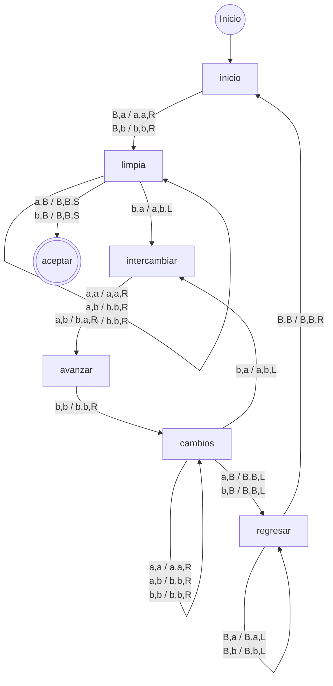

# MT alteradora: ordenar símbolos mediante intercambios vecinos

## Objetivo

Transformar una cadena no vacía sobre el alfabeto `{a, b}` para que todas las
`a` queden antes de las `b`, conservando la longitud y la cantidad de cada
símbolo.

Si la entrada contiene `m` símbolos `a` y `n` símbolos `b`, la salida será
`a^m b^n`, con `m, n >= 0` y `m + n >= 1`.

Por ejemplo, `babab` se transforma en `aabbb`. Una entrada ya ordenada o con
un solo tipo de símbolo conserva su contenido.

## Algoritmo elegido

1. Comenzar un recorrido de izquierda a derecha, sin intercambios registrados.
2. Comparar símbolos vecinos. Si forman `ba`, reemplazarlos por `ab` y
   registrar que hubo un intercambio.
3. Continuar el recorrido hasta el blank que delimita el extremo derecho.
4. Si hubo intercambios, regresar al inicio y comenzar otro recorrido,
   restableciendo el registro de cambios.
5. Si un recorrido completo termina sin intercambios, entrar al estado final.

Cada intercambio requiere varios pasos de la MT, porque el cabezal solo puede
leer y escribir una celda a la vez. La caché (`mem_cache_value`) guardará
temporalmente un símbolo durante la comparación y el intercambio. Los estados
distinguirán los recorridos con cambios de los recorridos sin cambios.

La máquina tendrá una sola cinta. El alfabeto de cinta previsto es
`{a, b, blank}`; el blank se escribirá como `null` o un valor vacío en YAML.
La caché comienza en blank, según las convenciones del simulador.

## Por qué funciona

Un intercambio `ba -> ab` conserva ambos símbolos y reduce en uno el número
de inversiones: pares de posiciones donde una `b` aparece antes que una `a`.
Como esa cantidad es finita y no negativa, solo puede haber una cantidad
finita de intercambios.

Si un recorrido no encuentra ningún par vecino `ba`, todas las `a` están
antes de las `b`. Por tanto, al detenerse, la cinta contiene la cadena ordenada
y conserva su longitud y sus cantidades originales. Para entradas no vacías,
la cinta final nunca queda completamente en blanco.

## Casos previstos para la demostración

Las cuatro entradas tienen longitud mayor o igual a 5 y todas se modifican.

| Entrada | Salida esperada | Caso |
| --- | --- | --- |
| `babab` | `aabbb` | Símbolos alternados. |
| `bbaaa` | `aaabb` | Todos los símbolos están en el orden opuesto. |
| `abbaba` | `aaabbb` | Varias inversiones separadas. |
| `bbbaab` | `aabbbb` | Las `a` deben cruzar tres `b`. |

También se verificaron cadenas ya ordenadas (`aabbb`), de un solo símbolo
(`bbbbb`) y cortas como `a`, `b`, `ab` y `ba`. La cadena vacía queda fuera del dominio definido.

## Diseño formal

Se usa `B` para representar el blank en este documento; no es la letra `b`.
En el YAML se representará mediante `null` o un valor vacío.

- Alfabeto de entrada: `Σ = {a, b}`.
- Alfabeto de cinta: `Γ = {a, b, B}`.
- Valores de caché utilizados: `{B, a, b}`.
- Estados: `Q = {inicio, limpia, cambios, intercambiar, avanzar, regresar, aceptar}`.
- Estado inicial: `[inicio, B]`, con el cabezal sobre el primer símbolo.
- Estado final: `aceptar`. La simulación termina al entrar en él.

### Estados y uso de la caché

| Estado | Función | Caché al entrar |
| --- | --- | --- |
| `inicio` | Leer el primer símbolo de un nuevo recorrido y avanzar. | `B` |
| `limpia` | Comparar vecinos; todavía no hubo intercambios en este recorrido. | Símbolo de la celda inmediatamente anterior. |
| `cambios` | Comparar vecinos; ya hubo al menos un intercambio en este recorrido. | Símbolo de la celda inmediatamente anterior. |
| `intercambiar` | Completar el cambio `ba -> ab`, escribiendo `a` en la celda izquierda. | `a`, pendiente de escribir. |
| `avanzar` | Pasar por la `b` derecha del par recién intercambiado y continuar. | `b`, que será el símbolo anterior al continuar. |
| `regresar` | Volver hacia la izquierda hasta el blank anterior a la cadena. | `B` |
| `aceptar` | Terminar con la cadena ordenada. | `B` |

En `limpia` y `cambios`, la caché contiene el vecino izquierdo y el cabezal
lee el vecino derecho. Si la caché es `b` y se lee `a`, hay que intercambiar.
Después del intercambio siempre se continúa en `cambios`.

### Tabla completa de transiciones

Cada fila representa `δ([q, caché], leído) = ([q', caché'], escrito, movimiento)`.
Los movimientos son `L` (izquierda), `R` (derecha) y `S` (sin movimiento).
No hay reglas implícitas: cualquier combinación ausente detiene la máquina
sin aceptación. En particular, no hay transición para la entrada vacía desde
`[inicio, B]` leyendo `B`.

| Regla | Estado | Caché | Lee | Estado siguiente | Caché siguiente | Escribe | Mueve |
| --- | --- | --- | --- | --- | --- | --- | --- |
| 1 | inicio | B | a | limpia | a | a | R |
| 2 | inicio | B | b | limpia | b | b | R |
| 3 | limpia | a | a | limpia | a | a | R |
| 4 | limpia | a | b | limpia | b | b | R |
| 5 | limpia | b | b | limpia | b | b | R |
| 6 | limpia | b | a | intercambiar | a | b | L |
| 7 | limpia | a | B | aceptar | B | B | S |
| 8 | limpia | b | B | aceptar | B | B | S |
| 9 | cambios | a | a | cambios | a | a | R |
| 10 | cambios | a | b | cambios | b | b | R |
| 11 | cambios | b | b | cambios | b | b | R |
| 12 | cambios | b | a | intercambiar | a | b | L |
| 13 | cambios | a | B | regresar | B | B | L |
| 14 | cambios | b | B | regresar | B | B | L |
| 15 | intercambiar | a | b | avanzar | b | a | R |
| 16 | avanzar | b | b | cambios | b | b | R |
| 17 | regresar | B | a | regresar | B | a | L |
| 18 | regresar | B | b | regresar | B | b | L |
| 19 | regresar | B | B | inicio | B | B | R |

### Ejemplo de un intercambio

Para el par `ba`, el cabezal comienza sobre la `a` derecha, con `b` en caché.

```text
b[limpia, b]a
    -> [intercambiar, a]bb   (escribe b en la derecha y se mueve a la izquierda)
    -> a[avanzar, b]b       (escribe a en la izquierda y se mueve a la derecha)
    -> ab[cambios, b]B      (avanza al siguiente símbolo, aquí el blank final)
```

Durante el intercambio aparece temporalmente `bb`; la caché conserva la `a`
que falta escribir. Al completar los dos primeros pasos, el par ya es `ab`.
Por eso la conservación de cantidades se aplica a intercambios completos
y a la salida, no necesariamente a cada paso intermedio de la cinta.

### Diagrama

Las etiquetas tienen la forma `caché, leído / caché siguiente, escrito, movimiento`.
Cada nodo muestra el componente `q`; la caché del estado `[q, caché]` se indica
en las aristas. Varias líneas en una arista representan reglas alternativas.



El círculo de entrada solo indica el inicio del diagrama; no es un estado
adicional. El estado final es `aceptar`.

### Ejemplo de recorridos

Para `babab`, los intercambios completos son:

```text
Primer recorrido:  babab -> abbab -> ababb
Segundo recorrido: ababb -> aabbb
Tercer recorrido:  aabbb -> aabbb (sin cambios: acepta)
```

Este resumen omite los pasos de regreso y las escrituras intermedias; las
descripciones instantáneas del simulador mostrarán cada paso individual.

## Pruebas automatizadas

Desde la raíz del repositorio, ejecutar las pruebas de la alteradora con:

```powershell
python -X utf8 -m unittest discover -s tests -p test_alteradora.py -v
```

Las pruebas cargan `maquinas/alteradora.yaml` mediante el parser real y usan
el simulador del proyecto. Verifican las cuatro entradas de demostración,
las 510 cadenas no vacías sobre `{a, b}` de longitud 1 a 8 y cinco entradas
de longitud 24 (orden opuesto, alternada, ordenada y de un solo símbolo).
Para cada entrada válida se comprueba la aceptación, el orden de la salida,
la conservación de la longitud y de las cantidades, y que la cinta final
no quede vacía. También se comprueba el rechazo de la cadena vacía y de
entradas con símbolos ajenos al alfabeto.

Estas comprobaciones cubren los casos indicados; la justificación general
de terminación y ordenación está en la sección «Por qué funciona».

Para ejecutar todas las pruebas del proyecto:

```powershell
python -X utf8 -m unittest discover -s tests -v
```
